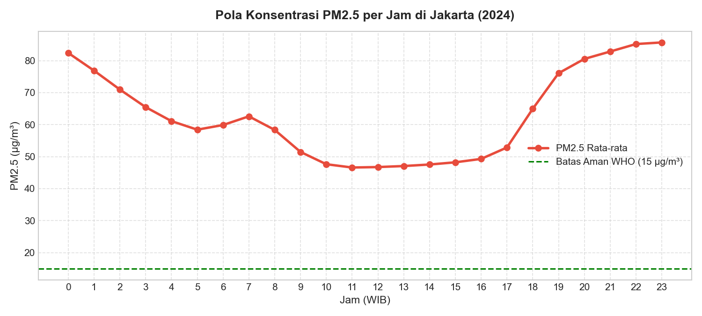
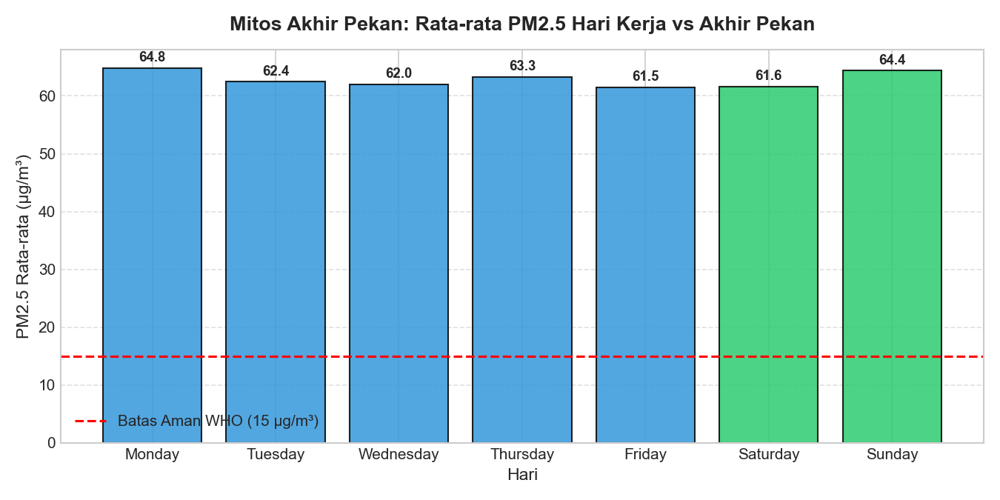
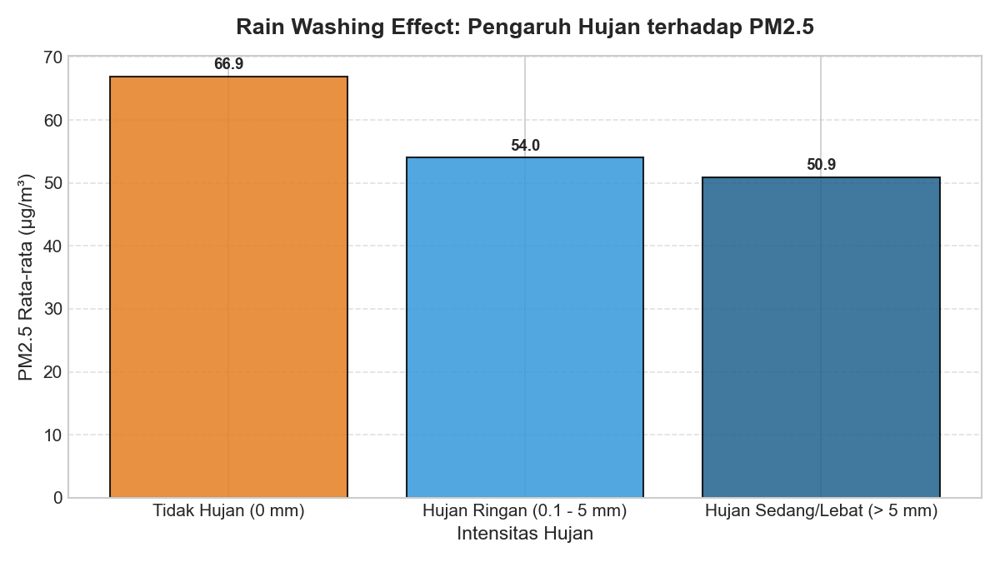
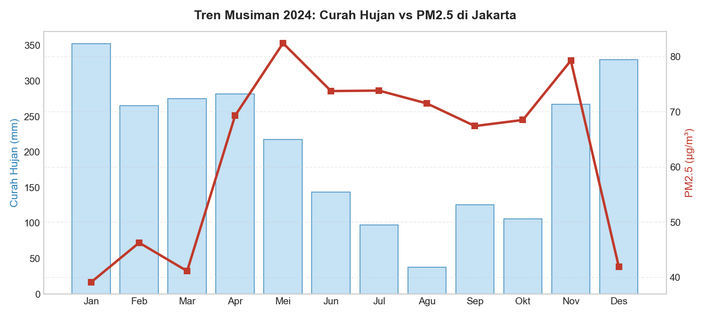

# 🏙️ Jakarta Urban Air Quality & Environmental Analytics (2024)

[](https://www.python.org/)
[](https://pandas.pydata.org/)
[](https://open-meteo.com/)
[-success.svg)]()

> Sebuah studi kasus data analitik komprehensif yang menganalisis **8.784 titik data historis per jam** sepanjang tahun 2024 untuk membedah dinamika polusi udara (PM2.5, PM10, AQI), anomali cuaca ekstrem, dan dampaknya terhadap aktivitas masyarakat di DKI Jakarta.

---

## 📌 Executive Summary

Analisis ini membedah krisis kualitas udara di DKI Jakarta sepanjang tahun 2024 menggunakan data riil berbasis sensor satelit dan pemodelan atmosfer. Temuan utama dari studi ini mematahkan beberapa asumsi umum masyarakat:

* 🚨 **Nol Hari Kategori "Baik"**: Dari 366 hari di tahun 2024, **0 hari (0%)** yang memenuhi kategori udara "Baik" (*Good*) menurut standar US EPA. Sebanyak **76,7% hari** berada dalam kategori "Tidak Sehat" hingga "Sangat Berbahaya".
* 🌙 **Puncak Polusi Terjadi Malam Hari**: Berlawanan dengan anggapan bahwa jam berangkat kerja adalah waktu paling berpolusi, konsentrasi PM2.5 justru memuncak pada jam **23.00 WIB (85,7 µg/m³)** akibat fenomena inversi suhu dan masuknya armada angkutan logistik berat.
* 🚗 **Mitos Akhir Pekan (*The Weekend Myth*)**: Tingkat polusi di hari Minggu (**64,4 µg/m³**) hampir identik dengan hari Senin (**64,8 µg/m³**), membuktikan bahwa emisi akhir pekan akibat mobilitas rekreasi dan kawasan industri penyangga sama dominannya dengan mobilitas komuter kantor.
* 🌧️ **Efek Hujan (*Rain Washing*)**: Curah hujan sedang/lebat mereduksi partikel PM2.5 sebesar **~24%** (dari 66,9 menjadi 50,9 µg/m³). Namun, konsentrasi tersebut tetap **3,3 kali lipat di atas batas aman WHO (15 µg/m³)**.

---

## 🎯 Stakeholders & Business Questions

Proyek ini dirancang untuk memberikan rekomendasi berbasis data bagi:
1. **Dinas Lingkungan Hidup & Dinas Perhubungan DKI Jakarta**
2. **Kementerian Kesehatan / Komunitas Olahraga Publik**
3. **Penyedia Layanan Transportasi & Mobilitas Publik**

### Pertanyaan Kunci yang Dijawab:
1. Pada jam berapa warga paling rentan terpapar polusi udara berbahaya?
2. Apakah libur akhir pekan efektif mereduksi polusi udara Jakarta?
3. Seberapa signifikan peran hujan lebat dalam menurunkan konsentrasi polutan atmosfer?
4. Kapan periode kritis musiman yang membutuhkan intervensi mitigasi darurat?

---

## 🛠️ Data Pipeline & Architecture

```
[ Open-Meteo Air Quality API ] \
                                --> [ Python Requests ] --> [ Pandas Merge (Timestamp) ] --> [ data/raw (8.784 Rows) ]
[ Open-Meteo Weather Archive ] /                                                                     ↓
                                                                                        [ Feature Engineering & EDA ]
                                                                                                     ↓
                                                                                        [ data/processed (Daily Aggregations) ]
```

* **Cakupan Wilayah**: DKI Jakarta (`Lat: -6.2088`, `Lon: 106.8456`)
* **Rentang Waktu**: 1 Januari 2024 – 31 Desember 2024 (1 Tahun Penuh)
* **Granularitas**: Data per Jam (*Hourly*, 8.784 baris)
* **Variabel Utama**:
  * *Kualitas Udara*: PM2.5, PM10, Carbon Monoxide (CO), Nitrogen Dioxide (NO2), US AQI.
  * *Parameter Cuaca*: Suhu (2m), Kelembaban Relatif, Curah Hujan (Precipitation), Kecepatan Angin.

---

## 🔍 Key Insights & Visualizations

### 1. Pola Jam: Mengapa Tengah Malam Paling Berbahaya?


* Konsentrasi terendah terjadi di siang hari pukul **11.00–14.00 WIB (46,6 µg/m³)** ketika radiasi matahari memicu konveksi vertikal udara.
* Mulai pukul 18.00 WIB, partikel PM2.5 terperangkap di lapisan bawah atmosfer (*temperature inversion*), diperparah oleh dibukanya akses jalan tol/arteri kota bagi truk diesel logistik berat. Puncaknya mencapai **85,7 µg/m³** pada pukul 23.00 WIB.

---

### 2. Mitos Hari Libur: Mengapa Minggu Sama Berpolusinya dengan Senin?


* Tidak ada perbedaan signifikan antara hari kerja (**62,0–64,8 µg/m³**) dan akhir pekan (**61,6–64,4 µg/m³**).
* Hari Minggu mencatatkan rata-rata **64,4 µg/m³**, melampaui rata-rata hari Selasa–Jumat. Hal ini menunjukkan bahwa emisi dari mobilitas warga menuju pusat perbelanjaan, tempat wisata, serta operasional industri penyangga di Bodetabek tetap berjalan masif di akhir pekan.

---

### 3. Rain Washing Effect: Meredam, Bukan Menghilangkan


* Hari tanpa hujan mencatat rata-rata PM2.5 sebesar **66,9 µg/m³**.
* Terjadi penurunan sebesar **19,3%** saat hujan ringan (0,1–5 mm) dan **23,9%** saat hujan lebat (>5 mm) menjadi **50,9 µg/m³**.
* **Catatan Kritis**: Meski hujan membantu pengendapan partikel debu (*wet deposition*), angka 50,9 µg/m³ tetap melampaui batas aman tahunan WHO. Hujan bukanlah solusi jangka panjang atas krisis polusi udara.

---

### 4. Tren Musiman: Krisis di Bulan Mei & November


* Hubungan terbalik yang sangat kuat antara volume curah hujan dan kepekatan PM2.5.
* **Bulan Terbersih**: Januari (39,1 µg/m³), Maret (41,1 µg/m³), dan Desember (41,9 µg/m³) dengan curah hujan >260–350 mm.
* **Bulan Paling Kritis**: Mei (**82,5 µg/m³**) dan November (**79,3 µg/m³**), menandai periode transisi kemarau di mana akumulasi debu dan polusi mencapai puncaknya.

---

## 💡 Strategic Recommendations

### 1. Untuk Kebijakan Transportasi (Dishub DKI):
* **Perluasan Pembatasan Emisi ke Akhir Pekan**: Mengingat hari Minggu sama berpolusinya dengan hari kerja, kebijakan ganjil-genap selektif di koridor wisata/rekreasi akhir pekan perlu dipertimbangkan.
* **Uji Emisi Ketat Angkutan Logistik Malam Hari**: Mengingat lonjakan polusi ekstrem di atas pukul 21.00 WIB, razia uji emisi berkala harus difokuskan pada gerbang tol masuk truk logistik malam hari.

### 2. Untuk Dinas Kesehatan & Publik:
* **Edukasi Tren Olahraga Malam (*Night Run*)**: Mengimbau masyarakat agar tidak melakukan aktivitas aerobik intensif di luar ruangan setelah pukul 20.00 WIB, karena paparan PM2.5 berada di level tertinggi harian.
* **Early Warning System Musiman**: Menyiapkan kampanye pembagian masker medis dan anjuran WFH saat memasuki bulan rawan polusi (Mei s.d. Oktober).

---

## 📂 Struktur Repositori

```text
urban-air-mobility-analysis/
├── assets/                  # Gambar grafik visualisasi untuk dokumentasi
│   ├── 01_hourly_pm25.png
│   ├── 02_weekend_myth.png
│   ├── 03_rain_washing_effect.png
│   └── 04_seasonal_trend.png
├── data/
│   ├── raw/                 # Data mentah API (diabaikan oleh .gitignore)
│   └── processed/           # jakarta_daily_summary_2024.csv (siap untuk BI)
├── notebooks/
│   ├── 01_fetch_environment_data.ipynb     # Pipeline ekstraksi data API
│   └── 02_exploratory_data_analysis.ipynb  # Analisis statistik & visualisasi
├── .gitignore               # Konfigurasi keamanan data
└── README.md                # Dokumentasi proyek portofolio
```

---

## 🚀 Cara Menjalankan Proyek Ini

1. **Clone Repositori**:
   ```bash
   git clone https://github.com/Adnin03/jakarta-air-quality-mobility-analysis.git
   cd jakarta-air-quality-mobility-analysis
   ```

2. **Install Dependensi**:
   ```bash
   pip install pandas numpy matplotlib requests
   ```

3. **Jalankan Notebook**:
   * Jalankan `notebooks/01_fetch_environment_data.ipynb` untuk mengunduh data mentah terbaru.
   * Jalankan `notebooks/02_exploratory_data_analysis.ipynb` untuk mereproduksi visualisasi dan data agregasi.

---

## 👤 Author
**Adnin Danil Azkia**  
Data Analyst Portfolio Project  
*Connect on [LinkedIn](https://linkedin.com) | [GitHub](https://github.com/Adnin03)*
